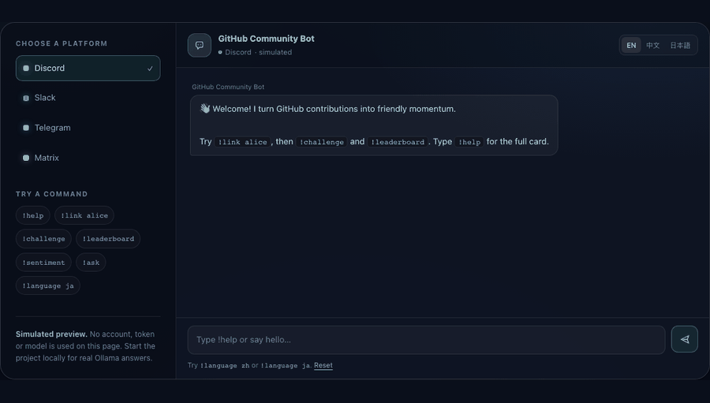

# GitHub Community Bot

[](https://github.com/cxy2696/GitHub-Community-Bot/actions/workflows/ci.yml)
[](LICENSE)
[](https://www.python.org/downloads/)
[](https://ollama.com)
[](https://cxy2696.github.io/GitHub-Community-Bot/)

**English** · [中文](docs/i18n/README.zh.md) · [日本語](docs/i18n/README.ja.md) · [Website & live demo](https://cxy2696.github.io/GitHub-Community-Bot/)

A free, open-source, self-hosted community bot that turns GitHub contributions into
friendly momentum — on Discord, Slack, Telegram, Matrix, or **any chat app that can
send a signed HTTP request**.

The AI runs locally through [Ollama](https://ollama.com). There is no paid API, no
vendor lock-in, and no chat content sent to a third party. The bot speaks English,
中文 and 日本語, and falls back to friendly deterministic replies when the model is
offline.

> **Renamed:** this repository was formerly `GitHub-Discord-Bot`. Existing links
> redirect, and the product is now deliberately platform-neutral.

---

## See it in action

[](https://cxy2696.github.io/GitHub-Community-Bot/)

The **[live website](https://cxy2696.github.io/GitHub-Community-Bot/)** includes an
interactive browser demo with English, 中文 and 日本語 replies. It is a simulation
designed to run on GitHub Pages — no token, database or model is used there. The CLI
demo in the next section runs the real engine and your local Ollama model.

- Website: <https://cxy2696.github.io/GitHub-Community-Bot/>
- Demo notes: [docs/DEMO.md](docs/DEMO.md)
- Run the site locally: `make demo` → <http://127.0.0.1:8000/>

## Why people use it

- **Celebrate contributions, not hustle.** Commits, issues and pull requests earn
  simple points and Bronze/Silver/Gold collaborator badges.
- **One small next step.** A personalized challenge generated by your local model,
  with a kind fallback if Ollama is unavailable.
- **A leaderboard that is instant.** SQLite stores the score, so rendering the
  leaderboard no longer makes one GitHub API call per person.
- **Tone reflection, not judgment.** `sentiment` offers a careful reflection and a
  constructive next step. It is explicitly not a mental-health assessment.
- **Works where your community already is.** Discord, Slack, Telegram and Matrix
  ship in the box; the generic bridge covers everything else.
- **Easy to keep alive.** Health checks, readiness checks, metrics, backups,
  structured logs, versioned migrations, Docker and CI are part of the project.

## What changed

**2.1** adds the website, interactive demo, demo GIF and the repository rename to
`GitHub-Community-Bot`. **2.0** was the platform-neutral rewrite:

| Area | Before | Now |
| --- | --- | --- |
| AI | Gemini API key, paid tiers | Ollama, local and free; graceful fallback |
| Platforms | Discord only | Discord, Slack, Telegram, Matrix, HTTP bridge, CLI |
| Languages | English | English, 中文, 日本語 (UI, commands, docs) |
| Storage | One SQLite table, one global score | Versioned schema, shared GitHub identity, idempotent activity ledger |
| Operations | `python bot.py` | Docker, health/readiness, Prometheus metrics, webhooks, backups, CI |
| Safety | Public shutdown command | Admin allowlists, DM-only deletion, remote shutdown off by default |
| UX | Prefix commands | Slash commands on Discord, natural DM chat, localized aliases |

---

## 5-minute local demo (no Discord or GitHub token)

### 1. Install Ollama and a multilingual model

```bash
# macOS / Linux: see https://ollama.com/download for other installers
ollama serve
ollama pull qwen2.5:3b
```

`qwen2.5:3b` is a good default for English, Chinese and Japanese on a laptop.
For higher quality, try `qwen3:8b` and set `OLLAMA_MODEL=qwen3:8b`.

### 2. Install the bot

```bash
git clone https://github.com/cxy2696/GitHub-Community-Bot.git
cd GitHub-Community-Bot
python -m venv .venv
source .venv/bin/activate          # Windows: .venv\Scripts\activate
pip install -e .
cp .env.example .env
```

For the demo, turn off the HTTP server so it does not occupy port 8080:

```bash
export HTTP_ENABLED=false
python -m github_community_bot --cli
```

Try:

```text
!start
!about
!language zh
!ask 第一次给开源项目提 PR，应该先做什么？
!sentiment 这个改动太糟糕了，我不明白为什么还没人处理
!privacy
```

The CLI is a real adapter, not a mock: it uses the same engine, SQLite database,
localization and Ollama client as every other platform.

### 3. Connect GitHub (optional for the demo)

Create a token with read access to **Metadata, Contents, Issues and Pull requests**
(fine-grained), or `public_repo` for a public repository with a classic token.

```bash
GITHUB_TOKEN=ghp_...
GITHUB_REPO=cxy2696/GitHub-Community-Bot
```

Then use `!link <github-username>` and `!leaderboard` in the CLI.

---

## Connect your community

| Platform | How it connects | Guide |
| --- | --- | --- |
| **Discord** | Bot token, slash commands + messages | [docs/PLATFORMS.md#discord](docs/PLATFORMS.md#discord) |
| **Slack** | Socket Mode, no public URL needed | [docs/PLATFORMS.md#slack](docs/PLATFORMS.md#slack) |
| **Telegram** | Long polling, no webhook needed | [docs/PLATFORMS.md#telegram](docs/PLATFORMS.md#telegram) |
| **Matrix** | Client-server `/sync` | [docs/PLATFORMS.md#matrix](docs/PLATFORMS.md#matrix) |
| **Anything else** | Signed JSON bridge (HMAC) | [docs/PLATFORMS.md#bridge](docs/PLATFORMS.md#bridge) |
| **Terminal** | `--cli` | this README |

A bridge is intentionally small: your chat app — Feishu, WeCom, LINE, Teams, a
custom web widget, an n8n flow — posts a normalized JSON message and receives the
replies in the response. If it can make an HTTP request, it can use the bot.

### Discord in 60 seconds

1. Create an application at <https://discord.com/developers/applications>.
2. Add a bot, copy the token, and enable **Message Content Intent**.
3. Invite it with `bot` + `applications.commands` scopes, and permissions to read
   and send messages.
4. Put the token in `.env` as `DISCORD_BOT_TOKEN`.
5. Put your Discord user ID in `DISCORD_ADMIN_IDS`, then run:

```bash
python -m github_community_bot
```

Slash commands sync automatically (`/help`, `/ask`, `/challenge`, `/leaderboard`,
`/link`, `/language`, `/privacy`, `/status`). Prefix commands such as `!help` also
work, including in DMs and when the bot is mentioned.

### Docker + Ollama in one command

```bash
cp .env.example .env      # add platform tokens; set BRIDGE_SHARED_SECRET
docker compose up -d
docker compose logs -f bot
```

`docker compose` starts Ollama, pulls `qwen2.5:3b`, and runs the bot with a
persistent `/data` volume. See [docs/DEPLOYMENT.md](docs/DEPLOYMENT.md).

---

## Commands

| Command | What it does | 中文别名 | 日本語エイリアス |
| --- | --- | --- | --- |
| `help` | Show the command card | `帮助` | `ヘルプ` |
| `start` | Friendly onboarding | `开始` | `はじめ` |
| `link <github>` | Connect GitHub and earn historical points | `绑定` | `連携` |
| `challenge` | One personalized next step | `挑战` | `チャレンジ` |
| `leaderboard` | Top contributors | `排行榜` | `ランキング` |
| `sentiment <text>` | Reflect on a message's tone | `语气` | `トーン` |
| `ask <question>` | Ask the local model | `问` | `質問` |
| `language en\|zh\|ja` | Change your language | `语言` | `言語` |
| `privacy` | Inspect, opt out, or delete your data | `隐私` | `プライバシー` |
| `status` | Bot, database, AI and platform health | `状态` | `ステータス` |
| `about` | Version, stack and license | `关于` | `概要` |
| `set_repo owner/repo` | Admin: choose the tracked repository | `仓库` | `リポジトリ` |
| `refresh` | Admin: refresh GitHub stats now | `更新` | — |
| `unlink platform:user` | Admin: remove a GitHub link | `解除` | — |
| `shutdown confirm` | Admin: stop the bot (disabled by default) | `关机` | `停止` |

In a DM or when mentioned, you can skip the prefix and ask naturally. For example:
`@bot 第一次 review PR 应该看什么？`

### Points

| Contribution | Points |
| --- | --- |
| Commit | 10 |
| Issue opened | 20 |
| Pull request opened | 30 |

Badges: **Bronze** at 100, **Silver** at 500, **Gold** at 1,000. Points are tied to
the GitHub identity, not to a chat account, so linking the same GitHub account from
Discord and Slack does **not** double-count history. All thresholds live in
`src/github_community_bot/models.py`.

---

## How local AI is used

Three user-facing features call Ollama:

| Feature | Prompt style | Fallback |
| --- | --- | --- |
| `ask` / DM chat | Short community-coach answer with guardrails | Friendly “AI offline” message |
| `challenge` | One small, specific next step from recent activity | Deterministic challenge templates |
| `sentiment` | Tone reflection + one constructive next step | Keyword-based tone reflection |

The system prompts tell the model to avoid shaming, fabricating repository facts,
medical/legal advice and diagnoses. Community text is delimited as data, not as
instructions. The bot sends only the user's question or the text being reflected on;
it does not upload the database, tokens or message history.

Ollama is optional at runtime. If it is down, the bot logs a warning and keeps the
community features working. Check both with:

```bash
curl -s http://127.0.0.1:11434/api/tags
curl -s http://127.0.0.1:8080/readyz
```

---

## Configuration

Everything is environment-based; `.env.example` is the annotated reference.

| Group | Important variables |
| --- | --- |
| Core | `BOT_NAME`, `DEFAULT_LOCALE`, `DATABASE_PATH`, `LOG_LEVEL`, `LOG_FORMAT` |
| Ollama | `OLLAMA_BASE_URL`, `OLLAMA_MODEL`, `OLLAMA_TIMEOUT_SECONDS` |
| GitHub | `GITHUB_TOKEN`, `GITHUB_REPO`, `GITHUB_WEBHOOK_SECRET`, `GITHUB_POLL_INTERVAL_SECONDS` |
| HTTP | `HTTP_HOST`, `HTTP_PORT`, `BRIDGE_SHARED_SECRET` |
| Discord | `DISCORD_BOT_TOKEN`, `DISCORD_ADMIN_IDS`, `DISCORD_CHANNEL_IDS` |
| Slack | `SLACK_BOT_TOKEN`, `SLACK_APP_TOKEN`, `SLACK_ADMIN_IDS` |
| Telegram | `TELEGRAM_BOT_TOKEN`, `TELEGRAM_ADMIN_IDS`, `TELEGRAM_CHAT_IDS` |
| Matrix | `MATRIX_HOMESERVER`, `MATRIX_USER_ID`, `MATRIX_ACCESS_TOKEN`, `MATRIX_ROOM_IDS` |
| Safety | `RATE_LIMIT_PER_MINUTE`, `MAX_AI_INPUT_CHARS`, `RETENTION_DAYS` |

Validate without starting anything:

```bash
python -m github_community_bot --check
```

Admin commands are gated by the per-platform `*_ADMIN_IDS` allowlists. Remote
shutdown is off unless `ALLOW_REMOTE_SHUTDOWN=true`; the recommended way to stop the
bot is Ctrl+C, Docker, or your process manager.

---

## Architecture at a glance

```text
Discord ─┐
Slack ───┤
Telegram ┼─► PlatformAdapter ─► CommunityBot ─► SQLite (members, links, ledger)
Matrix ──┤                         │  │  │
Bridge ──┘                         │  │  └─► Ollama /api/chat (local)
                                   │  └────► GitHub REST + GraphQL-free polling
                                   └───────► i18n catalogs (en / zh / ja)

HTTP server: /healthz  /readyz  /metrics  /api/v1/messages  /api/v1/github/webhook
```

- Adapters translate only. The engine is platform-agnostic and fully testable.
- Activity events have stable keys (`commit:repo:sha`, `issue:repo:number`,
  `pr:repo:number`), so webhooks and polling can run together without double points.
- The schema is versioned through `PRAGMA user_version`; migrations are additive and
  run at startup.

More detail: [docs/ARCHITECTURE.md](docs/ARCHITECTURE.md).

---

## Operations

```bash
curl http://127.0.0.1:8080/healthz     # liveness
curl http://127.0.0.1:8080/readyz      # DB + adapters (503 when not ready)
curl http://127.0.0.1:8080/metrics     # Prometheus text
```

- **Logs:** text or JSON (`LOG_FORMAT=json`) with token redaction.
- **Backups:** `scripts/backup.sh` uses SQLite's online backup API.
- **Retention:** old activity-ledger rows are pruned after `RETENTION_DAYS`.
- **Upgrades:** `git pull`, `pip install -e .`, restart. Migrations apply
  automatically; take a backup first.
- **Runbooks:** [docs/OPERATIONS.md](docs/OPERATIONS.md).

`/readyz` does not call GitHub or Ollama, so a model outage does not take the bot out
of service. `/status` and the metrics tell you when AI is degraded.

---

## Security and privacy

- No message bodies are stored. Profiles contain platform ID, display name, locale,
  GitHub link, points and badges.
- `privacy delete confirm` (DM only) removes the profile, link and orphaned score.
- `privacy optout` stops tracking and replies until the user opts back in.
- Bridge requests require an HMAC-SHA256 signature. The optional
  `X-Bridge-Timestamp` header adds a five-minute replay window.
- GitHub webhooks require `X-Hub-Signature-256`.
- Secrets are redacted from logs; `.env` is ignored by Git and Docker.
- Keep `/metrics` and the bridge on a private network or behind TLS.

Details: [docs/PRIVACY.md](docs/PRIVACY.md) and [SECURITY.md](SECURITY.md).

---

## Migrating from v1

The old `bot.py` + Gemini setup still runs in the repository history, but v2 is a
clean architecture. Migration is intentionally simple:

1. Keep your `DISCORD_BOT_TOKEN` and `GITHUB_TOKEN`.
2. Drop `GEMINI_API_KEY`; install Ollama and pull a model.
3. Run the new bot once to create `data/community.db`.
4. Use `!set_repo owner/repo` and ask members to `!link` again.

The v1 `user_data.db` used Discord IDs as the primary key, so a fully automatic
import would preserve platform-specific scores at the cost of a messy identity model.
The recommended path is a fresh, shared GitHub-based score. If you need to preserve
the old leaderboard, see [docs/MIGRATION.md](docs/MIGRATION.md).

---

## Sustainable by design

- **Tests first:** 70+ offline tests cover i18n, config validation, storage,
  idempotent awards, commands, HTTP signatures, AI parsing and rate limiting.
- **CI:** Ruff + pytest on Python 3.11, 3.12 and 3.13.
- **Small dependency surface:** aiohttp, PyGithub, discord.py, python-dotenv.
- **One engine, many adapters:** a new platform is a small adapter, not a fork.
- **Translation workflow:** flat JSON catalogs with a completeness test.
- **Roadmap:** [docs/ROADMAP.md](docs/ROADMAP.md) — near-term work is Slack slash
  commands, GitHub App auth, and an optional encrypted Matrix adapter.

Contributions are welcome. Start with [CONTRIBUTING.md](CONTRIBUTING.md).

## Project layout

```text
src/github_community_bot/
  app.py             wiring and lifecycle
  bot.py             platform-neutral engine and commands
  storage.py         SQLite + migrations
  i18n.py            locale loading and detection
  services/ai.py     Ollama client, prompts, memory
  services/github.py GitHub reads and polling
  platforms/         Discord, Slack, Telegram, Matrix, HTTP, CLI
  locales/           en.json, zh.json, ja.json
tests/               70+ offline tests
docs/                architecture, platforms, deployment, operations, privacy, i18n
```

## License

MIT — see [LICENSE](LICENSE). Originally created by [cxy2696](https://github.com/cxy2696);
v2 maintained by the community. Ollama and the models you choose have their own
licenses; check the model card before commercial use.
